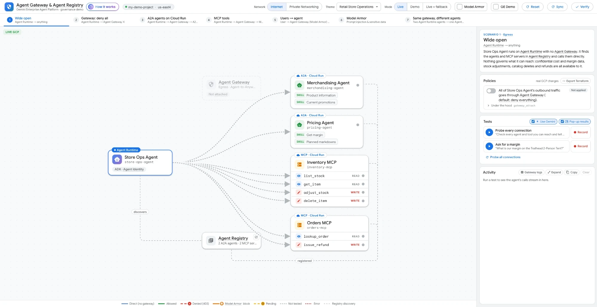
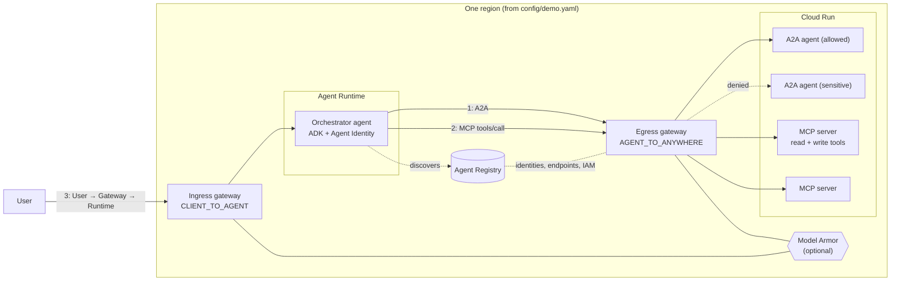

# Agent Gateway & Agent Registry Demo

Once agents can call other agents, MCP servers and APIs on their own, you need a way to control who they talk to, which tools they can use and what goes in and out, without building that into every agent.

That's what **Agent Gateway** does. It sits in the network path of your agents on Agent Runtime and enforces policy in one place:
- **Agent → anywhere (egress):** default deny. An agent can only reach destinations registered in **Agent Registry** that its Agent Identity has been granted, down to individual MCP tools.
- **Client → agent (ingress):** requests coming into the agent are screened before the agent ever sees them.
- **Model Armor** plugs into either side to catch prompt injection, jailbreaks and sensitive data (SSNs, card numbers, etc.).

**Protocols:** the gateway understands **MCP** (it sees every `tools/call` and the tool name, so policy can be per tool) and governs **A2A** and plain **HTTPS** calls to registered destinations. On ingress it covers Agent Runtime's `query` / `streamQuery`. This demo shows:
- **A2A:** ADK agents on Cloud Run called over A2A (JSON-RPC `message/send`)
- **MCP:** MCP servers on Cloud Run over Streamable HTTP, with read-only vs write tools
- **Client → Agent Runtime:** `streamQuery` through the ingress gateway with Model Armor
- **HTTPS to Google APIs:** the Gemini, session, logging and tracing calls the agent itself needs, allowlisted as registry endpoints

## Why I built this

Showing Agent Gateway for real is a lot of work. You need an agent on Agent Runtime, A2A agents and MCP servers on Cloud Run, all of it registered in Agent Registry, two gateways, IAP and Model Armor authz extensions and policies... and then the IAM policies themselves, which get complicated fast (agent identity principals, conditional bindings on MCP tool names, etc.). Each change takes minutes to apply, and it's hard to see what actually changed.

So this repo does the heavy lifting. One config file and a small CLI build the whole environment in your own project, and a web UI lets you turn policies on and off in plain English ("Helpdesk Agent can only use the tickets MCP server's read-only tools") and watch the result on a live diagram.

The goal isn't just to show off what the gateway can do. It's also to give you a look **under the hood** at how the policies are crafted and applied in different situations: every policy has an "Under the hood" view with the exact gcloud / REST calls behind it, and the gateway's own Cloud Logging entries show up next to each call.

The demo starts with an ADK agent that can call anything. Step by step you put it behind the egress gateway (default deny), allow specific A2A agents and specific MCP tools, put the ingress gateway in front of it and turn on Model Armor. Every call is drawn as a line and colored by outcome: direct, allowed, denied (403), blocked (Model Armor) or pending.

Use cases are pluggable **themes** (YAML only). Two ship with the repo: *IT / HR Helpdesk* and *Retail Store Operations*.

> **All target services are mocks.** The A2A agents and MCP servers return fake data from the theme files. No real tickets, orders, refunds, HR records or prices are read or changed.



*Scenario 1 (Wide open) in Live mode: Helpdesk Agent on Agent Runtime calls every A2A agent and MCP tool directly; the Agent Gateway is not attached yet.*

## What it shows

| # | Scenario | Point it makes |
|---|---|---|
| 1 | Wide open | No gateway: the agent reaches every agent and tool, including sensitive and destructive ones |
| 2 | Gateway: deny all | Binding the engine to the egress gateway denies everything except platform endpoints |
| 3 | A2A agents on Cloud Run | Identity-based allow of one A2A agent, deny of another (`iap.egressor` on Agent Registry entries) |
| 4 | MCP tools | Per-tool policy: read-only MCP tools allowed, write and delete tools denied, either by listing tool names or by the tools' MCP `readOnlyHint` annotations |
| 5 | Users → agent | Every call into the agent goes through the ingress gateway; with Model Armor on, a prompt injection or PII is blocked (403) before it reaches the agent |
| 6 | Model Armor | Prompt injection and sensitive data in MCP tool calls blocked by the egress gateway, even where policy allows the tool |
| 7 | Same gateway, different agents | Two Agent Runtime agents share one egress gateway; each has its own Agent Identity and its own grants, so the same question to the same destination is allowed for one agent and denied for the other. Access follows identity, not network location |

## Architecture



The three flows:
1. **Runtime → Gateway → A2A agent on Cloud Run.** The orchestrator calls remote ADK agents (`to_a2a()`) over A2A. The egress gateway allows a call only if the orchestrator's Agent Identity holds `roles/iap.egressor` on that agent's registry entry.
2. **Runtime → Gateway → MCP server on Cloud Run.** The orchestrator calls FastMCP servers over Streamable HTTP. The gateway sees each `tools/call`, so policy can allow a whole server or just its read-only tools.
3. **User → Gateway → Runtime.** The ingress gateway sits in front of the Agent Runtime agent and screens requests with Model Armor, blocking prompt injection and sensitive data before they reach the agent. It doesn't authorize callers by identity: who may call the agent is IAM on Agent Runtime (`roles/aiplatform.user`).

**The role of Agent Registry:** it's the catalog of every A2A agent (with its agent card and skills), every MCP server (with its tools) and the allowlisted platform endpoints. The orchestrator discovers what it can call from it, and the gateway's policy is IAM on registry entries. Anything not registered and granted is denied.

More detail: [docs/ARCHITECTURE.md](docs/ARCHITECTURE.md). Interfaces between the parts: [docs/CONTRACTS.md](docs/CONTRACTS.md).

## Words you'll see

| Term | In plain words |
|---|---|
| **Agent Gateway** | A Google-managed checkpoint every call goes through. **Egress** (Agent-to-Anywhere) checks calls *from* your agent; **ingress** (Client-to-Agent) screens calls *to* your agent |
| **Agent Runtime** | Google's managed hosting for agents (formerly Agent Engine / reasoning engines) |
| **Bound** | An agent attached to a gateway, so its traffic goes through it. All agents in a project and region share the same gateways |
| **Agent Registry** | The address book of destinations (agents, MCP servers, APIs). Egress only reaches what's registered: **default deny** |
| **`roles/iap.egressor`** | The permission slip: an agent may call a registry entry only if it holds this role on it (optionally only certain MCP tools) |
| **Agent Identity** | The agent's own identity (its "badge"), set when it's created. Grants are given to it |
| **IAP** | Identity-Aware Proxy: Google's access check. It decides egress calls, and signs people in to the demo UI |
| **Model Armor** | Content screening (prompt injection, sensitive data) the gateway can apply |
| **Service account** | A non-human identity that a deployed service runs as |
| **Private Networking terms** | Network attachment, PSC endpoint, connectivity template: see [Private Networking mode](#private-networking-mode) |

## Install in your own environment

Allow about 30–45 minutes, mostly waiting on Google Cloud. The full guide, with permissions and options, is **[docs/SETUP.md](docs/SETUP.md)**.

**1. Prerequisites**
- A Google Cloud project with billing, where you are Owner (or hold the admin roles `preflight` checks for).
- A region where Agent Gateway, Agent Runtime, Agent Registry and Cloud Run are all available (us-east4 is tested). All Agent Runtime agents in a project and region must share the same gateways, so pick a region where no agents are bound to other gateways.
- `gcloud` (with beta components), **Terraform 1.7+**, [`uv`](https://docs.astral.sh/uv/) and Python 3.11+. Images are built with Cloud Build, so Docker isn't required. Node is only needed for UI development; `agents-cli` only for the optional Gemini Enterprise step.

**2. Get the code and configure it**

```bash
git clone https://github.com/mlaslie/agent-gateway-demo.git && cd agent-gateway-demo
cp config/demo.example.yaml config/demo.yaml
gcloud auth login && gcloud auth application-default login
```

Two logins, both as you: the first lets the `gcloud` command act as you; the second creates **Application Default Credentials (ADC)**, which Terraform and the Python SDK pick up automatically. The deployed UI uses neither. It runs as its own service account, and viewers sign in through IAP (a Google sign-in gate in front of the app).

In `config/demo.yaml` set at least:

| Key | Value |
|---|---|
| `environment.project_id` | Your project |
| `environment.region` | A supported region |
| `environment.resource_prefix` | Short unique prefix for every resource (default `agdemo`) |
| `ui.iap_access` | Who can open the UI, e.g. `group:demo-viewers@example.com` |
| `ui.admin_access` | Presenters who can change policies (they also get `roles/aiplatform.user`) |
| `gemini_enterprise.*` | Optional: your Gemini Enterprise app, for GE Demo mode |
| `private_networking.enabled` / `.region` | Optional: Private Networking mode. The region must differ from `environment.region` (one egress gateway per project and region) |

**3. Check the environment**

```bash
./agdemo preflight          # auth, billing, roles, APIs, region support, gateway conflicts (--fix enables APIs)
```

**4. Create everything in one go** (about 40–55 minutes)

```bash
./agdemo up                 # Terraform foundation, every themes.enabled theme, the UI, then a verify
```

`up` runs steps 4b, 5 and 7 below: `tf init`, a plan with the plan-safety check (no deletes or replaces), apply, `output-sync`, the images once, `deploy-theme` for each theme, `ui deploy`, then a read-only verify. It's idempotent; `--theme`, `--no-ui`, `--skip-build` and `--ge` narrow or extend it. To go step by step instead:

**4b. Create the shared resources** (about 10–20 minutes)

```bash
./agdemo tf init && ./agdemo tf apply   # gateways, IAP + Model Armor authz, registry allowlist, SAs, repo, bucket
```

(`./agdemo bootstrap` is deprecated: it points at `up`, and `bootstrap --legacy` runs the old non-Terraform path.)

**5. Deploy the themes** (about 10–15 minutes each)

```bash
./agdemo deploy-theme helpdesk
./agdemo deploy-theme retail
```

Each theme gets its A2A agents and MCP servers on Cloud Run, their Agent Registry entries, and an orchestrator on Agent Runtime with Agent Identity and **no gateway**: the wide-open starting point. Themes with `additional_orchestrators` (both shipped themes, for scenario 7) also get a second Agent Runtime agent, with its own Agent Identity and no gateway.

**6. Optional: publish the agents to Gemini Enterprise** (needed for GE Demo mode)

Agents are **not** added to Gemini Enterprise automatically. Set `gemini_enterprise.app_id`, `location` and `app_url` in `config/demo.yaml`, then register each theme's orchestrator in that app:

```bash
./agdemo publish-ge helpdesk     # adds "Helpdesk Agent (Agent Gateway demo)"
./agdemo publish-ge retail       # adds "Store Ops Agent (Agent Gateway demo)"
```

Only the primary agent is published; `./agdemo publish-ge <theme> --agent <id>` publishes a second agent (e.g. `--agent hr-assistant`) instead. This is an ADK registration (Gemini Enterprise calls the Agent Runtime agent directly), so it uses the same agent and the same gateways as the UI. It's idempotent; re-run it if you recreate a theme's agent (`deploy-theme --recreate-engine`). Presenters need `roles/aiplatform.user`, which the foundation grants to `ui.admin_access`.

**7. Deploy the UI**

```bash
./agdemo ui deploy          # Cloud Run behind IAP; prints the URL (or: ./agdemo ui local)
```

Re-run `ui deploy` after any `deploy-theme` or config change: the UI receives its config and deployment state at deploy time.

**8. Check it and prepare**

Open the UI, pick a theme, choose **Live** and click **Verify** to confirm the wide-open start state. Then walk through [docs/DEMO_SCRIPT.md](docs/DEMO_SCRIPT.md). Optionally **Record** key tests in the policy state you'll present them in, so Demo and fallback modes replay real answers.

Everything (project, region, names, principals) comes from `config/demo.yaml`. Every resource is named `<prefix>-…` and labeled, so several copies can share a project. Commands are idempotent: if a step fails, fix the cause and run it again.

No Google Cloud project? `./agdemo ui local --mode demo` runs the whole UI in simulated mode.

To take a policy state to production, `./agdemo export-terraform <theme> [--out DIR] [--include-shared]` writes Terraform for the theme's current Live policy state (default `config/generated/terraform/<theme>`; read-only). The same export is in the UI (**Export Terraform** on the Policies card).

### Terraform and the environment lifecycle

The foundation is Terraform (`infra/terraform/`, `hashicorp/google` >= 8.7.0, Terraform >= 1.7; [docs/TERRAFORM_PLAN.md](docs/TERRAFORM_PLAN.md)); the CLI keeps everything built from code and every live toggle. An environment created by the old `bootstrap` (the original live demo) is adopted with `./agdemo tf import` first: follow [docs/TERRAFORM_MIGRATION_RUNBOOK.md](docs/TERRAFORM_MIGRATION_RUNBOOK.md). Until then `up` and `down` refuse it.

```bash
./agdemo up                      # tf init, plan + safety check, apply, output-sync, deploy-theme each theme, ui deploy, verify
./agdemo reset --all             # every theme back to wide open, Model Armor off, prefix-owned Policy Studio leftovers removed
./agdemo check-clean [--strict]  # read-only: is anything left besides the foundation? exit 1 with a list
./agdemo down                    # reset --all, GE unregister, delete engines/Cloud Run/registry/UI, check-clean --strict, terraform destroy
```

- **`reset --all`** keeps the foundation and every deployed engine and service. Per theme it removes the applied policies (one gateway PATCH per engine) and waits for the engine updates. Then Model Armor goes off, and leftovers on prefix resources are removed: authz policies on our gateways named `<prefix>-*` *and* labelled `demo-prefix=<prefix>`, the Terraform IAP policy pointed back at its extension, the IAP enforcement mode back to `demo.yaml`, unused prefix extension copies, and IAP grants on prefix registry entries (platform entries keep only the project-wide egressor). Anything that isn't ours is reported, never changed. `--dry-run` prints the plan; a second run does nothing.
- **`check-clean`** fails (exit 1) on blocking findings: engine bindings to this environment's gateways (any owner), theme engines, theme Cloud Run services, prefix registry entries, grants on them, CONTENT_AUTHZ or other authz policies on our gateways, non-foundation prefix extensions and Model Armor templates. `--strict` also fails on warnings: the UI service, Gemini Enterprise registrations, foundation drift, legacy resources, a stale state.json and any check it couldn't read. `--json` for scripts.
- **`down`** asks you to type `<project>/<prefix>` (or `--yes --prefix <prefix>`), and warns that nobody may be presenting. `--dry-run` prints the inventory and the reset plan. It keeps the APIs, the state bucket, the recordings bucket and the project-wide shared grants (presenters' `aiplatform.user`, the service agents' Model Armor roles), which other environments in the project may rely on.
- **Destroy guard:** `terraform_data.teardown_guard` (`infra/terraform/guards.tf`) runs `./agdemo check-clean --strict` when it's destroyed, before anything else, so a bare `terraform destroy` stops while anything still uses the gateways. `-target`, `terraform state rm` or removing the block bypass it.

Single Terraform steps, for the runbook and debugging:

```bash
./agdemo tf init                 # tfvars from config/demo.yaml, state bucket <project>-agdemo-tfstate (versioned), terraform init
./agdemo tf plan                 # terraform plan + plan-safety check (refuses deletes and replaces); read-only
./agdemo tf apply                # recordings bucket (outside Terraform), plan, check, apply, then output-sync
./agdemo tf output-sync          # merge outputs into config/state.json `shared` (same keys bootstrap writes)
./agdemo tf check-plan plan.json # plan-safety check on `terraform show -json` output (--migration: only additive creates)
./agdemo tf import               # T2: imports.tf (generated, git-ignored) adopting a bootstrap-created environment
./agdemo tf recordings-bucket    # create the recordings bucket (outside Terraform) before copying recordings into it
```

Each environment has its own state prefix (`<prefix>/<project>/<region>`). `config/state.json` belongs to one environment per checkout: use a separate checkout for a second environment, and set `terraform.shared_project_grants: false` in its config when the project already has one. `tf init --local-state PATH` (also `up`/`down --local-state`) uses a local scratch state.

## What gets created

Names below use the default prefix `agdemo` (`environment.resource_prefix`); `<project>` and `<region>` come from `config/demo.yaml`. Everything is in that one region and labeled `app=agent-gateway-demo, demo-prefix=agdemo`. `./agdemo status` lists what exists; `./agdemo down` removes it.

### Shared (created once by `./agdemo up`: Terraform, then `./agdemo ui deploy`)

| Service | Resource | Name | Purpose |
|---|---|---|---|
| **Agent Gateway** | Egress gateway | `agdemo-egress` | `AGENT_TO_ANYWHERE`, bound to the regional Agent Registry. Default deny for agents bound to it |
| | Ingress gateway | `agdemo-ingress` | `CLIENT_TO_AGENT`, in front of Agent Runtime agents bound to it |
| **Service Extensions** (authz extensions) | IAP extension | `agdemo-egress-iap-authz` | Lets IAP decide each egress request (`roles/iap.egressor` on registry entries) |
| | Model Armor extension | `agdemo-ma-authz` | Calls Model Armor for content screening (`modelarmor.<region>.rep.googleapis.com`) |
| **Network Security** (authz policies) | IAP policy | `agdemo-egress-iap-policy` | `REQUEST_AUTHZ` on the egress gateway, always on (`ENFORCE` by default) |
| **Model Armor** | Template | `agdemo-shield` | Prompt injection / jailbreak + sensitive data (SDP) filters, custom block message `agdemo-model-armor-block` |
| **Agent Registry** | 25 platform endpoint services | `agdemo-plat-<host>` (e.g. `agdemo-plat-us-east4-aiplatform`, `agdemo-plat-logging-mtls`) | The Google APIs an Agent Runtime agent needs under default deny (Gemini, sessions, logging, trace, monitoring, IAM credentials, registry), each with `roles/iap.egressor` for all agents in the project |
| **Cloud Run** | UI service | `agdemo-ui` | The demo UI behind IAP (one always-on instance) |
| **IAM** | Service accounts | `agdemo-ui`, `agdemo-targets` | UI backend (applies policies, reads logs); identity of the Cloud Run demo agents and MCP servers |
| | Project roles | see [ARCHITECTURE.md](docs/ARCHITECTURE.md) §12 | UI SA: Agent Platform user, IAP admin, network security editor, service extensions admin, Model Armor viewer, logging viewer… Targets SA: `aiplatform.user`, `logging.logWriter`. `ui.admin_access` presenters: `aiplatform.user`. Gateway service agents: Model Armor callout roles |
| **Artifact Registry** | Docker repo | `agdemo` | Images `mcp-server`, `a2a-agent`, `ui` (built with Cloud Build) |
| **Cloud Storage** | Bucket | `<project>-agdemo-staging` | Agent Runtime staging, plus `recordings/` for recorded test runs |

### Per theme (created by `./agdemo deploy-theme <theme>`)

Each theme deploys the same four kinds of resources. Cloud Run services and Agent Registry services are named `agdemo-<theme>-<component>`.

| Service | Resource | `helpdesk` (IT / HR Helpdesk) | `retail` (Retail Store Operations) |
|---|---|---|---|
| **Agent Runtime** | Orchestrator (reasoning engine, ADK, Agent Identity, no gateway at first) | `agdemo-helpdesk-orchestrator` (Helpdesk Agent) | `agdemo-retail-orchestrator` (Store Ops Agent) |
| | Second agent for scenario 7 (`additional_orchestrators`: same package and topology, its own Agent Identity, no gateway at first) | `agdemo-helpdesk-hr-assistant` (HR Assistant) | `agdemo-retail-pricing-analyst` (Pricing Analyst) |
| **Cloud Run** | A2A agent: the one allowed in step 3 | `agdemo-helpdesk-kb-agent` | `agdemo-retail-merchandising-agent` |
| | A2A agent: the sensitive one | `agdemo-helpdesk-hr-records-agent` | `agdemo-retail-pricing-agent` |
| | MCP server with read + write tools | `agdemo-helpdesk-tickets-mcp` (`list_tickets`, `get_ticket` / `close_ticket`, `delete_ticket`) | `agdemo-retail-inventory-mcp` (`list_stock`, `get_item` / `adjust_stock`, `delete_item`) |
| | Second MCP server | `agdemo-helpdesk-directory-mcp` (`lookup_user` / `reset_password`) | `agdemo-retail-orders-mcp` (`lookup_order` / `issue_refund`) |
| **Agent Registry** | One service per component (A2A agents with their agent card and skills, MCP servers with their tool list) | Same names as the Cloud Run services | Same names as the Cloud Run services |
| | Orchestrators | Each one (primary and second agent) is registered automatically by Agent Runtime as an agent | Same |
| **IAM** | Project roles for each orchestrator's Agent Identity principal (primary and second agent) | `aiplatform.user`, `agentregistry.viewer`, `logging.logWriter`, `monitoring.metricWriter`, `cloudtrace.agent`, `browser`, `serviceusage.serviceUsageConsumer` | Same |
| **Gemini Enterprise** (optional, `./agdemo publish-ge`) | Agent registration in your GE app | "Helpdesk Agent (Agent Gateway demo)" | "Store Ops Agent (Agent Gateway demo)" |

The A2A agents and MCP servers are the same two generic images configured from the theme's YAML (`agents.yaml`, `tools.yaml`); they return mock data only.

### What each control changes in GCP (Live mode)

These are created or removed only while the demo runs; **Reset** removes all of them.

| Control | Example (helpdesk) | GCP change |
|---|---|---|
| Egress gateway policy | `gw-egress`, `gw-egress-hr` | PATCH that agent's engine `agentGatewayConfig.agentToAnywhereConfig` → `agdemo-egress` (the agent redeploys, ~5 min). `gw-egress-hr` binds HR Assistant's engine to the same gateway |
| Ingress gateway policy | `gw-ingress` | PATCH `agentGatewayConfig.clientToAgentConfig` → `agdemo-ingress` (~2½ min) |
| Allow an A2A agent | `allow-kb`, `allow-hr` | `roles/iap.egressor` for the orchestrator's Agent Identity on that agent's Agent Registry entry |
| Allow an A2A agent, per agent | `hr-assistant-allow-hr`, `hr-assistant-allow-kb` | The same grant for the **second agent's** Agent Identity (the policy's `source`), so each agent's access is decided by its own identity |
| Allow a whole MCP server | `tickets-all`, `allow-directory` | `roles/iap.egressor` on that MCP server's Agent Registry entry |
| Allow read-only MCP tools, by name | `tickets-readonly` | The same binding with an IAM condition listing the allowed tool names: `iap.googleapis.com/mcp.toolName in ['list_tickets', 'get_ticket', '']` |
| Allow read-only MCP tools, by MCP hint | `tickets-readonly-hints` | The same binding with an IAM condition on the tool's annotation: `iap.googleapis.com/mcp.tool.isReadOnly == true`, which the gateway takes from `readOnlyHint` in the tool spec registered in Agent Registry. No tool names in the policy |
| **Model Armor** checkbox | (all themes) | Creates `agdemo-egress-ma-policy` and `agdemo-ingress-ma-policy` (`CONTENT_AUTHZ`, via `agdemo-ma-authz` and template `agdemo-shield`); unticking deletes them (~4 min) |

Retail uses the same patterns with its own ids (`allow-merch`, `allow-pricing`, `inventory-readonly`, `inventory-readonly-hints`, `inventory-all`, `orders-lookup`, `allow-orders`, and for Pricing Analyst `gw-egress-pricing`, `pricing-analyst-allow-pricing`, `pricing-analyst-allow-merch`). **Under the hood** in each policy shows the exact commands.

## Using the UI

### Modes

| Mode | Policy toggles | Running a test |
|---|---|---|
| **Live** | Real GCP changes. Each one shows a progress card with "takes effect in about N min" and a countdown (grants and revokes about 2 min, up to about 7; gateway bind / unbind about 5 min; Model Armor a few minutes), then "should be in effect now" until GCP confirms it | Real calls through the real gateways |
| **Demo** | Simulated and instant; nothing changes in GCP | Replays a matching recording, otherwise simulates the outcome from the scenario rules (with sample answers). Works with no GCP project |
| **Live + fallback** | Real GCP changes, as in Live | Real calls, but if a policy change is still pending or a call fails, it replays a recording or simulates instead (marked *replayed*) |

Use **Live + fallback** when presenting.

### Model Armor and GE Demo

- **Model Armor** turns Model Armor on or off on both gateways at once (it's global, across themes). On the ingress gateway it screens every request into the agent; on the egress gateway it screens MCP tool calls. A blocked call shows as an orange shield and a 403.
- **GE Demo** drives the demo from **Gemini Enterprise** instead of this UI. Clicking a test copies its prompt to the clipboard so you can paste it into Gemini Enterprise and send it to the theme's agent there: **"Helpdesk Agent (Agent Gateway demo)"** or **"Store Ops Agent (Agent Gateway demo)"**. Ticking the box does **not** register the agent; run `./agdemo publish-ge <theme>` once first (install step 6). The agent's outbound calls go through the same gateway, so policy changes you make here show up there. **Show what happened** lights up the diagram for that prompt, and the activity log picks up the gateway's own log entries for calls made from Gemini Enterprise.

### Header controls

| Control | What it does |
|---|---|
| **Theme** | Switches use case (e.g. IT / HR Helpdesk, Retail Store Operations) |
| **Reset** | Back to step 1 for the selected theme: removes every policy, detaches both gateways in one change, turns Model Armor off, opens the Wide open tab and clears the log. Policies that weren't applied are reported as "not present". In Live it then verifies the start state automatically |
| **Sync** | Re-reads every policy and Model Armor straight from GCP and clears any stuck *pending* state; logs what is actually in place |
| **Verify** | Checks that the theme is at the start state: every policy removed, both gateways detached, Model Armor off and every connection direct, as a ✓/✗ checklist |

### Side panel

- **Scenario tabs and talk track:** one tab per step, with a description to read from.
- **Policies:** each policy in plain English with an apply/remove toggle and its status. **Under the hood** shows the exact gcloud / REST calls, with Expand and Copy. **Export Terraform** generates Terraform (HCL, `hashicorp/google` >= 8.1.0) for the policies currently in place: IAP egressor grants with the same conditions the demo applies, the gateway binding (a `terraform_data` PATCH, since no resource binds an existing engine) and the Model Armor authz policies. Tabs for `main.tf` / `variables.tf` / `README.md`, an **Include shared infrastructure** toggle (gateways, authz extensions, Model Armor template, Agent Registry entries, IAM), Copy and Download (.zip). The Agent Runtime engine and Cloud Run services are referenced, not managed. Read-only: nothing is changed in GCP.
- **Tests:** each test sends a prompt to the agent. With **Use Gemini** off, the agent makes a fixed, repeatable set of calls (fast and predictable); with it on, Gemini decides which tools to call and writes the answer (realistic, may vary). **Record** saves a Live run for replay. **Probe all connections** checks every connection.
- **Activity:** a live log of each prompt, call and answer. **Gateway logs** opens a live feed of the gateway's own allow/deny decisions from Cloud Logging, each linked to the entry in Cloud Logging; denied lines on the diagram get a log badge. **Expand** and **Copy** work on the whole log.

### Diagram

Each line is a call, colored by outcome: **direct** (no gateway), **allowed**, **denied** (403 from the gateway), **blocked** (Model Armor), **pending** (a policy change in progress), **error** or **not tested**. MCP servers show each tool as its own row, so tool-level policy is visible per tool.

Click the **Agent Registry** node on the diagram to browse what's registered: the theme's A2A agents with their skills, the MCP servers with each tool's READ / WRITE annotations, and the platform endpoints. Each entry lists who can call it (the `roles/iap.egressor` bindings, with any condition and the policy that created it) or "No one — default deny". In Live it reads Agent Registry and IAP (read-only) and refreshes every 10 s, so applying a policy shows the new binding appear.

### Learning aids

- **Terms on hover:** words with a dotted underline (Agent Gateway, egress, Agent Registry, `roles/iap.egressor`, Model Armor, PSC endpoint, …) show a one-line explanation on hover, keyboard focus or tap. The wording is the [Words you'll see](#words-youll-see) table and the Private Networking pieces table.
- **Why / fix:** each failed call in the Activity log, Test results and Gateway logs (and the diagram line's tooltip) gets one line on why it failed and one on what to do: 403 not authorized (no registry entry or no grant, or a grant not in effect yet), Model Armor block, a write tool under a read-only grant, 404 from an internal Cloud Run service, 401 behind a template gateway, blocked platform endpoints, unreachable / timeout. See [docs/TROUBLESHOOTING.md](docs/TROUBLESHOOTING.md) for more.
- **How it works (?):** the **?** next to the title opens the call path in one picture: agent → Agent Gateway (checkpoint) → Agent Registry (address book) + IAP grant (permission slip) → destination, with the default-deny rule; in Private Networking also network attachment → PSC endpoint → private service.

## Themes

| Theme | Orchestrator | A2A agents | MCP servers |
|---|---|---|---|
| `helpdesk`: IT / HR Helpdesk | `helpdesk-agent`, plus `hr-assistant` (scenario 7) | `kb-agent` (allowed), `hr-records-agent` (denied) | `tickets-mcp` (read: list/get; write: close/delete), `directory-mcp` |
| `retail`: Retail Store Operations | `store-ops-agent`, plus `pricing-analyst` (scenario 7) | `merchandising-agent` (allowed), `pricing-agent` (denied) | `inventory-mcp` (read: list_stock/get_item; write: adjust_stock/delete_item), `orders-mcp` (lookup_order / issue_refund) |
| `privnet`: Private networking (Private Networking mode, us-west1) | `payroll-agent` | none | `payroll-mcp` (Cloud Run ingress **internal**; read: get_payslip, write: update_bank_details), `benefits-mcp` (public; list_plans / enroll) |

A new theme is a folder of YAML. Start from `themes/_template/` and follow [docs/ADDING_A_THEME.md](docs/ADDING_A_THEME.md).

## Private Networking mode

The header's **Network** switch picks **Internet** (the themes above, base region, `agdemo-egress` without a VPC) or **Private Networking**: a VPC-enabled egress gateway, `<prefix>-pn-egress`, in a second region (default us-west1), created by Terraform **with** an agent connectivity template from the start. Design and decisions: [docs/TERRAFORM_PLAN.md](docs/TERRAFORM_PLAN.md) §7c and §7f; gotchas: [docs/PRIVATE_EGRESS_TESTBED.md](docs/PRIVATE_EGRESS_TESTBED.md).

**The pieces, in plain words:**

| Piece | What it does |
|---|---|
| **VPC + /28 subnet** (Private Google Access on) | Your private network, plus a small dedicated subnet the gateway plugs into |
| **Network attachment** | The gateway's door into your VPC: Google's side connects to it automatically |
| **PSC endpoint for Google APIs** | A private IP inside your VPC that leads to Google services such as Cloud Run, so internal-only services can be reached without the internet |
| **Private DNS zone `run.app.`** | Your VPC's phone book entry: inside the VPC, `*.run.app` names resolve to the PSC endpoint's private IP |
| **DNS peering** | Lets the gateway look names up in your VPC's phone book |
| **Agent connectivity template** | One resource holding the gateway's private-network settings: which attachment (VPC), which domains to look up there, which traffic goes in. The gateway points at it |
| **Gateway service agent roles** | Permission for Google's gateway identity to use your attachment and read your DNS |

Policy doesn't change: the agent still needs a registry entry and `roles/iap.egressor`. The VPC only adds a private route.

**Turn it on:** set `private_networking.enabled: true` in `config/demo.yaml` (block in `demo.example.yaml`), then `./agdemo up`. Terraform adds `modules/private_egress` (VPC, /28 subnet with Private Google Access, network attachment, PSC endpoint for Google APIs, private `run.app.` zone with apex and wildcard records, `gcp-sa-agentgateway` networkAdmin + dns.peer, the content-hashed template) and `modules/regional` (the gateway, its IAP extension and REQUEST_AUTHZ policy, the region's 25 platform registry entries with their egressor grant, a staging bucket). The base region's plan doesn't change. `deploy-theme privnet` deploys Payroll MCP with `--ingress=internal`, registers both run.app URL forms, and deploys the orchestrator. `status`, `reset --all`, `check-clean` and `down` cover both regions.

**Demo steps** (theme `privnet`, all live toggles; they also run in Demo mode without GCP):
1. **Internal only:** the *Bypass* test calls Payroll MCP from the UI backend (no agent, no gateway): 404. The agent without the gateway also gets 404. Benefits MCP answers directly.
2. **Through the gateway:** attach the gateway. There's a route into the VPC and both servers are in Agent Registry (Payroll with both URLs and its tool spec), but no grant: 403 for both. A route and a registry entry aren't permission.
3. **Grant Payroll:** all tools or read-only only: 200, and the gateway log entry is marked **private path** (`httpRequest.serverIp` = the PSC endpoint, 10.x). With read-only, `update_bank_details` stays 403.
4. **Grant Benefits, same policy:** Benefits MCP follows the same registry + IAP rules. Unlike Payroll it is also reachable from the internet directly, but through this gateway it takes the private path too (serverIp is the PSC endpoint), because the gateway resolves every `*.run.app` name inside the VPC.

The diagram shows the VPC between the gateway and Payroll MCP (attachment, PSC endpoint, DNS); **Under the hood: private network** in the side panel lists the pre-built pieces and the template, from `state.json shared.regions` after `up` (or as `up` would name them). No ingress gateway and no Model Armor in this mode.

## Repo layout

```
agdemo                 CLI entry point (preflight, bootstrap, deploy-theme, publish-ge, ui, status, reset, teardown)
agdemo_core/           shared Python: config loader, state, theme schema, simulator, policy handlers
agdemo_core/infra/     step implementations used by the CLI (gateways, registry, IAM, Model Armor, IAP)
infra/terraform/       Terraform foundation: root + modules/base + guards.tf; driven by ./agdemo up/down and ./agdemo tf
runtimes/
  orchestrator/        generic ADK agent for Agent Runtime, configured per theme
  a2a_agent/           generic ADK A2A agent image for Cloud Run
  mcp_server/          generic FastMCP server image for Cloud Run
themes/<id>/           theme packs: theme.yaml, agents.yaml, tools.yaml, scenarios/, recordings/
ui/backend/            FastAPI: theme API, policy handlers, mode engine (live / demo / fallback)
ui/frontend/           React + React Flow diagram
config/                demo.example.yaml (committed); demo.yaml and state.json (git-ignored)
docs/                  documentation (below)
```

## Docs

| Doc | For |
|---|---|
| [SETUP.md](docs/SETUP.md) | Deploying into your own project |
| [DEMO_SCRIPT.md](docs/DEMO_SCRIPT.md) | Presenter runbook and talk track (10–15 minutes and 5 minutes) |
| [ADDING_A_THEME.md](docs/ADDING_A_THEME.md) | Writing a new theme; schema and policy-type reference |
| [ARCHITECTURE.md](docs/ARCHITECTURE.md) | How the pieces fit together, and the GCP resources behind each policy |
| [CONTRACTS.md](docs/CONTRACTS.md) | Internal interfaces: node and edge ids, simulator rules, handlers, API, recordings |
| [TROUBLESHOOTING.md](docs/TROUBLESHOOTING.md) | Common failures and fixes |
| [ISSUES.md](docs/ISSUES.md) | Product gaps and surprises found while building this demo, and how the demo handles them |

## Cleanup

```bash
./agdemo reset --all        # back to the start state for presenting; keeps everything deployed
./agdemo teardown <theme>   # one theme's Cloud Run services, registry entries and Agent Runtime agents
./agdemo down               # the whole environment, Terraform foundation included (see above)
```

`teardown --all` is the old non-Terraform path; on a Terraform-managed environment it refuses (use `down`) unless `--legacy`. None of them disable APIs or touch resources they didn't create.

## Disclaimer

This is a demonstration, not a production reference. The mock services return fake data, the policies are simplified for clarity, and some of the features used (Agent Gateway, Agent Registry, Agent Runtime gateway binding) may be in Preview and can change. Run it in a dedicated or sandbox project.

## License

Apache License 2.0. See [LICENSE](LICENSE).
